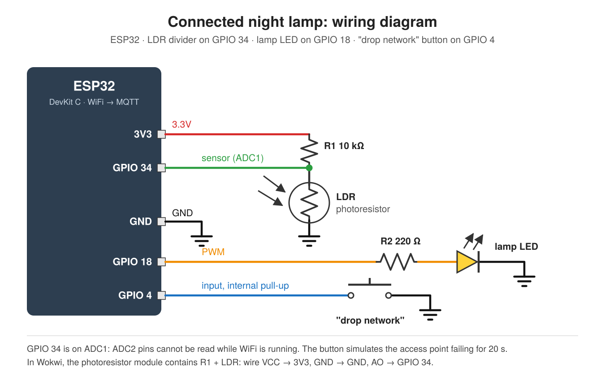

# Connected Night Lamp (Task 03, Network-connected device)

The night lamp from [Task 01](https://github.com/ChinmayDubey231/light-sensor-night-lamp) and [Task 02](https://github.com/ChinmayDubey231/non-blocking-night-lamp), moved to an **ESP32**. It publishes its light readings over **MQTT** and copes with an unreliable network. When WiFi or the broker drops, readings are **buffered in RAM** and sent **in order** once the connection is back. Each reading carries a sequence number, so anyone receiving them can see that nothing was lost.

| Requirement | How |
|---|---|
| Data published over WiFi / MQTT | One JSON reading every 2 s to `chinmaydubey231/night-lamp/readings` on `broker.hivemq.com`, via WiFi and [PubSubClient](https://github.com/knolleary/pubsubclient) |
| Reconnect logic that works | WiFi and MQTT reconnect **separately**, each with exponential backoff (MQTT retries at 1, 2, 4, 8, 16, then 30 s, plus jitter). A broker outage does not restart WiFi. A last-will message marks the device `offline` if it disappears. |
| Readings buffered while offline | 300-reading ring buffer (10 minutes). Sent oldest-first, and each reading is removed only after `publish()` succeeds. If the buffer fills, the oldest readings are dropped and counted, never silently lost. |
| Evidence of data arriving | [`evidence/`](evidence/): real subscriber log and device serial logs, showing readings arriving through the public broker plus two real reconnects |



## What gets published

`chinmaydubey231/night-lamp/readings`, one message per reading:

```json
{"seq":42,"t":84000,"age":0,"level":1810,"lamp":97,"dropped":0}
```

| Field | Meaning |
|---|---|
| `seq` | 1, 2, 3… never reused. A jump means readings were lost; a repeat means a duplicate. |
| `t` | device uptime (ms) when the reading was taken |
| `age` | how long the reading waited in the buffer before it was sent. `0` = live; for example, `18000` = buffered for 18 s during an outage. |
| `level` | light sensor, 12-bit (0 = bright, 4095 = dark) |
| `lamp` | lamp PWM brightness, 0–255 |
| `dropped` | total readings ever discarded because the buffer was full |

`chinmaydubey231/night-lamp/status` is `online` (published on connect, retained) or `offline` (the last-will message the broker publishes if the device vanishes).

## How to run

### 1. Start the device (Wokwi simulator, no hardware)

1. Open <https://wokwi.com/projects/new/esp32>.
2. Paste [`sketch.ino`](sketch.ino) into the `sketch.ino` tab and [`diagram.json`](diagram.json) into `diagram.json`.
3. Add a file named `libraries.txt` (the **▾** next to the tabs → *New file…*) and paste [`libraries.txt`](libraries.txt) into it. This installs PubSubClient.
4. Press **Start** (▶). The Serial Monitor shows the device joining `Wokwi-GUEST`, then connecting to the broker:
   ```
   [wifi] connected, IP 10.10.0.2
   [mqtt] connecting to broker.hivemq.com...
   [mqtt] connected, 2 reading(s) waiting
   [stats] level=680 lamp=0 wifi=up mqtt=up buffered=0 published=3 dropped=0
   ```

### 2. Watch the data arrive

Use either of these:

- **Script** (recommended, it checks for gaps and saves evidence):
  ```sh
  pip install paho-mqtt
  python tools/subscriber.py
  ```
- **No install:** open the [HiveMQ web client](https://www.hivemq.com/demos/websocket-client/), click *Connect*, then *Add New Topic Subscription* → `chinmaydubey231/night-lamp/#`.

### 3. Break the network

Press the red **drop network** button in Wokwi. For 20 s the device behaves as if its access point has died. Then:

- Serial shows `[wifi] connection LOST, buffering readings`, and `buffered=` counts up. The lamp keeps reacting to the light slider throughout.
- The subscriber goes quiet. After about 20–30 s it may show `STATUS offline`: the broker publishing the last will.
- When the "AP" comes back, the device rejoins WiFi, reconnects to MQTT and sends the backlog. The subscriber prints the held-back readings with `[buffered, waited 18.0 s]`, in order, with `missing=0`.

### On real hardware

ESP32 DevKit, LDR, 10 kΩ, 220 Ω, an LED and a push button, wired as in the diagram. Change `WIFI_SSID` and `WIFI_PASSWORD` at the top of `sketch.ino`, install **PubSubClient** from the Library Manager, and upload with the *ESP32 Dev Module* board selected.

## How it works

```
loop()   (never waits, except the MQTT connect noted below)
 ├─ every 100 ms   read LDR → set lamp               works offline
 ├─ every 2 s      reading → ring buffer             always, online or not
 ├─ manageWifi()   lost? retry: immediately, then backoff 2 s, 4 s … 30 s
 ├─ manageMqtt()   WiFi up but no broker? connect with last will,
 │                 backoff 1 s, 2 s, 4 s … 30 s
 └─ flushBuffer()  connected? publish oldest-first, up to 20 per pass,
                   pop each reading only after publish() returns true
```

## Decisions

- **Every reading goes through the buffer, even live ones.** There is only one send path, so readings can't overtake each other when the connection comes back. A reading sent within the same loop pass shows `age: 0`.
- **Remove a reading only after `publish()` succeeds.** If the connection dies halfway through sending a backlog, the unsent readings stay queued and go out after the reconnect. The tests cut the connection mid-backlog to check this.
- **Sequence numbers instead of QoS 1.** PubSubClient can only publish at QoS 0. `publish()` returning true means the message reached the TCP socket, not that the broker confirmed it. The `seq` field makes any loss visible end-to-end, and `tools/subscriber.py` counts gaps and duplicates. Proper QoS 1 would need a different MQTT library.
- **When full, drop the oldest.** 300 readings is 10 minutes of history in about 3.6 KB of RAM. In a longer outage, the newest data is the most useful to keep, and the `dropped` field plus the `seq` gap show exactly how much was lost.
- **Separate WiFi and MQTT reconnects.** A broker outage shouldn't restart a working WiFi link, and MQTT shouldn't be tried with no WiFi. ESP32's built-in WiFi auto-reconnect is turned off so the behaviour is explicit and testable.
- **Exponential backoff with jitter.** Retrying quickly at first recovers fast from blips. Doubling up to a 30 s cap avoids hammering a network or broker that is really down. Up to 25% random jitter stops many devices that lost the same network from all retrying at the same moment.
- **Unique client ID from the MAC address** (`night-lamp-123456`). On a public broker, two clients with the same ID keep disconnecting each other. The Wokwi simulator has no factory MAC (it reads as all zeros), so in that case the ID comes from the ESP32's hardware random number generator instead.
- **Last will + retained status.** Subscribers can tell "device offline" apart from "device online but quiet".
- **Sensor on GPIO 34.** It is on ADC1. The ESP32's ADC2 pins cannot be read while WiFi is active.
- **Known trade-off: `mqtt.connect()` blocks.** PubSubClient's connect waits for the TCP handshake, capped at a few seconds by the socket timeout. During that time the lamp isn't updated. The timers skip ahead instead of bursting afterwards, and readings keep their real timestamps. Removing this pause would mean running the network code in its own FreeRTOS task, which is more than this task needs.
- **Public broker, no TLS or password.** This keeps the demo runnable by anyone in one click. A real deployment would use a private broker with TLS and credentials.

## Tests

`test/` compiles the real `sketch.ino` on a normal computer against fake `WiFi` and `PubSubClient` libraries. The fakes can take the access point or the broker away mid-run, or kill the connection partway through sending a backlog.

```sh
./test/run_tests.sh      # needs g++
python tools/subscriber.py --self-test
```

```
Connected night lamp (sketch.ino)
  ok   client id taken from the MAC (night-lamp-123456), not zeros
  ok   no factory MAC (simulator): random id instead (night-lamp-abcdef)
  ok   connects to WiFi and the MQTT broker
  ok   last will set: "offline" on status topic, retained
  ok   publishes retained "online" after connecting
  ok   14 readings published in 30 s (one per 2 s)
  ok   readings arrive in order, no gaps (seq 1..14)
  ok   live readings are sent immediately (age 0 ms)
  ok   WiFi down: nothing published (0 new)
  ok   WiFi down: 30 readings buffered in 60 s
       WiFi retry gaps (ms): 12210 14860 19690
  ok   WiFi retries back off and are capped (3 retries)
  ok   WiFi back: buffer drained (0 left)
  ok   WiFi back: every reading delivered once, in order (seq 1..74)
  ok   oldest buffered reading waited 60000 ms (it is marked with its age)
       MQTT retry gaps (ms): 1020 2110 4390 8100 18630 34110 36380
  ok   MQTT retries: ~1, 2, 4, 8, 16, 30 s (+ up to 25% jitter)
  ok   MQTT retries never wait longer than 30 s + jitter
  ok   broker outage does not tear down WiFi
  ok   broker back: backlog delivered in order (seq up to 164)
  ok   drop mid-flush: no reading lost or duplicated
  ok   at most 20 publishes per loop pass (limit 20)
  ok   button: link down, no join attempts during the 20 s outage
  ok   button: readings held back while down (10 buffered)
  ok   button: reconnects by itself and delivers the backlog in order
  ok   offline: lamp still responds to the dark (pwm=255)
  ok   offline: lamp still turns off in light
  ok   15 min offline: buffer capped at 300 readings
  ok   oldest readings dropped and counted (153 dropped)
  ok   after long outage: buffer drained
  ok   after long outage: newest 10 min delivered in order
  ok   the seq gap (153) matches the reported "dropped" count, so loss is visible
  all passed
```

(Each WiFi retry gap is the 10 s allowed for a join attempt plus the backoff.)

## Files

```
sketch.ino            ESP32 firmware
diagram.json          Wokwi circuit
libraries.txt         Wokwi library list (PubSubClient)
wiring-diagram.svg    wiring diagram (source)
wiring-diagram.png    wiring diagram (image)
tools/subscriber.py   subscriber that logs readings and checks for gaps
evidence/             subscriber and serial logs from real runs
test/                 host-side tests with fake WiFi and MQTT
```
